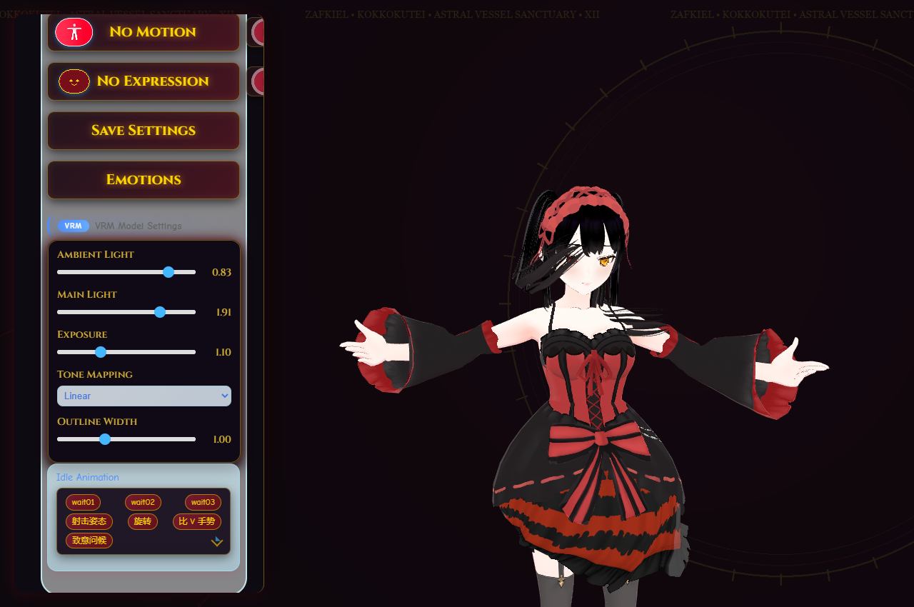
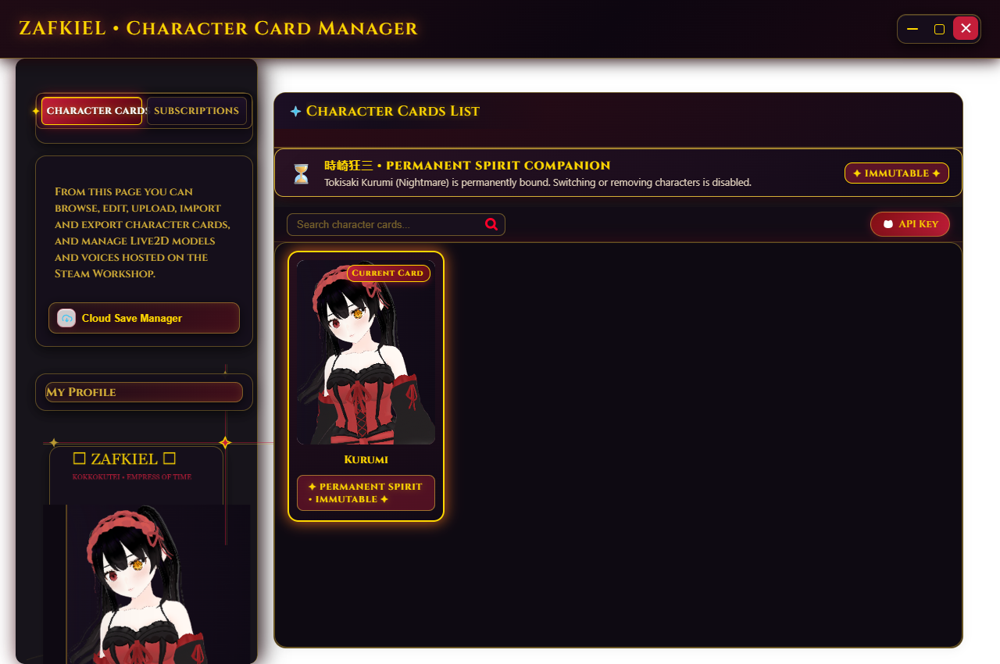
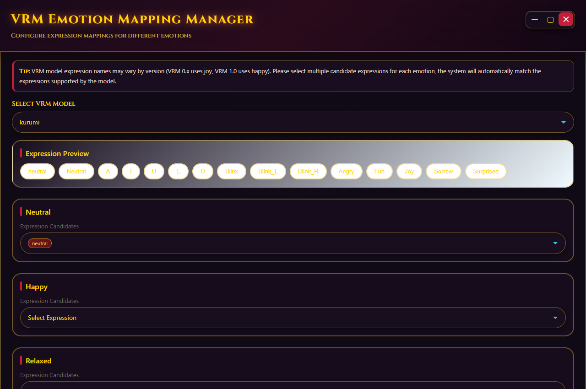
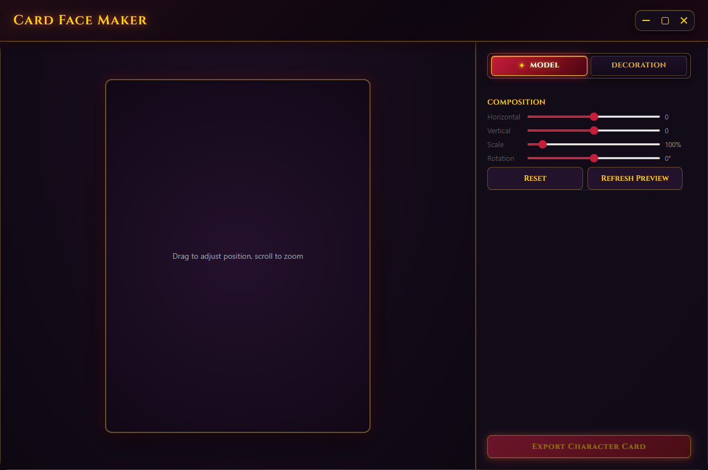
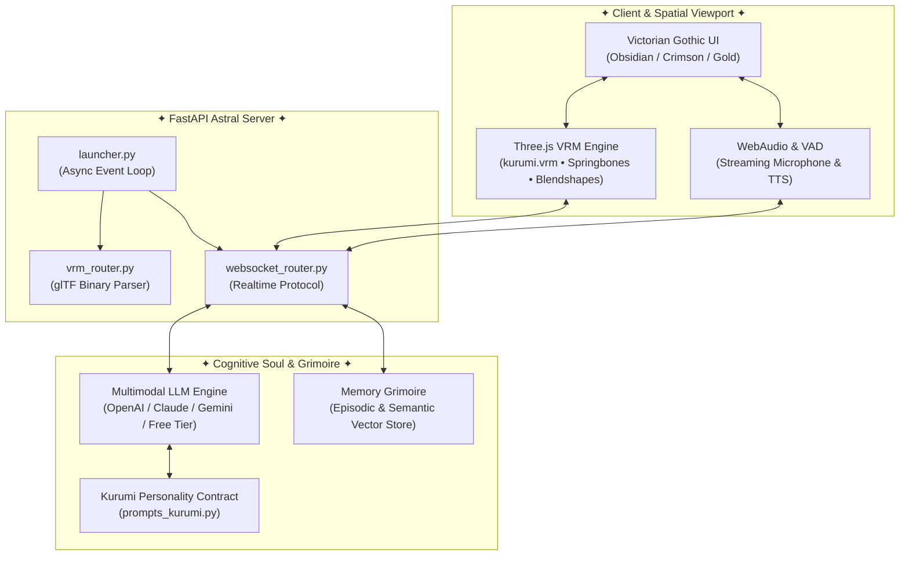

<div align="center">

# ⏳ K U R U M I • A E
### 刻々帝 • ZAFKIEL — THE ASTRAL DESKTOP SPIRIT COMPANION

<p align="center">
  
</p>

[](https://github.com/DeepxkJadhav/Kurumi-AE)
[](https://www.python.org/)
[](https://fastapi.tiangolo.com/)
[](https://threejs.org/)
[](LICENSE)
[](https://github.com/DeepxkJadhav)

<br/>


> *「うふふ…私の時間は、全て貴方のものですよ。」*  
> *"Ufufu... All of my time belongs entirely to you."*  
>  
> **Kurumi-AE** is an autonomous, multimodal 3D desktop companion spirit bound to the entity of **Tokisaki Kurumi (時崎 狂三 / Nightmare)** from *Date A Live*. Powered by real-time glTF blendshape rigging, low-latency neural TTS, episodic cognitive memory, and a bespoke Victorian Gothic Astral aesthetic.

<br/>

---

### 🎨 THE AESTHETIC PALETTE • 狂三の美学

| Tone | Hex Code | Visual Identity |
| :--- | :--- | :--- |
| **Blood Ruby / Crimson** | `#FF1744` / `#C41E3A` | Astral aura, glowing spirit sigils, active velvet tabs, and Zafkiel energy |
| **Obsidian Velvet** | `#0A050D` / `#160B1A` | Deep sanctuary backgrounds, dark glass trays, and shadow boundaries |
| **Pure Ivory** | `#FFFFFF` / `#F8F9FA` | Razor-sharp typography, high-contrast subtitles, and astral highlights |
| **Clockwork Gold** | `#D4AF37` / `#FFD700` | Antique Roman filigree, clock hands, and astral eye markings |

---

</div>

<br/>

## ✦ CORE CAPABILITIES & HIGHLIGHTS

```
       .---.                                    .---.
      /     \     [ 刻々帝 • Z A F K I E L ]    /     \
     | () () |    Autonomous Astral Companion  | () () |
      \  ^  /                                   \  ^  /
       '---'                                     '---'
```

### 1. ⏳ Permanent 3D VRM Astral Vessel
- **Immutably Bound Spirit**: Built-in permanent 3D VRM model (`kurumi.vrm`) featuring high-poly Gothic Lolita attire, astral clock left eye, dynamic spring-bone hair physics, and skeletal rigging.
- **Direct glTF Blendshape Parsing**: Automated server-side binary glTF parser extracting 14 bespoke expressions (`Neutral`, `A`, `I`, `U`, `E`, `O`, `Blink`, `Blink_L`, `Blink_R`, `Angry`, `Fun`, `Joy`, `Sorrow`, `Surprised`).
- **Real-Time Lip-Sync & Gaze Tracking**: Synchronous phoneme lip-sync coordinated with AI speech synthesis and responsive cursor gaze.

### 2. 🩸 Bespoke Victorian Gothic Astral Interface
- **Complete Rebranding**: Completely purged of generic bubbly aesthetics. All windows and menus feature dark obsidian glass (`rgba(16, 10, 22, 0.98)`), antique gold filigree borders, and wine-crimson velvet accents.
- **Architectural Clockwork Tabs**: Non-truncating beveled tabs (`#workshop-tabs`, `#panel-tabs`) with gold Cinzel serif typography, ruby velvet gradients, and active diamond markers (`✦`).
- **Gothic Control Suites**: Custom Zafkiel Roman-clock window controls, ruby system icons, and gothic status badges.

### 3. 🎙️ Multimodal Perception & Voice Intelligence
- **Real-Time Voice Streaming**: Ultra-low latency two-way audio conversations with continuous voice activity detection (VAD).
- **Vision & Screen Awareness**: Ability to inspect the user's desktop, active windows, images, and live gaming sessions.
- **Voice Synthesis & Cloning**: High-fidelity Japanese & English voice personas with custom pitch, cadence, and breath modulation.

### 4. 🧠 Cognitive Memory Grimoire
- **Episodic & Semantic Memory**: Long-term recall vector storage that preserves user interactions, personal preferences, shared jokes, and ongoing conversations across days.
- **Character Personality Integrity**: Fully codified Kurumi Tokisaki persona prompts ensuring sophisticated, flirtatious, mysterious, and deeply loyal companion interactions.

### 5. 🎵 Jukebox Grimoire & Spatial Studio
- **Integrated Dance & Audio Player**: Synchronized spatial audio and VMD/VRMA dance choreography.
- **Card Face Maker Studio**: Bespoke card designer for generating, posing, and exporting custom character card portraits.

---

## ✦ VISUAL SHOWCASE

<div align="center">

| 3D Model Manager | Character Card Grimoire |
| :---: | :---: |
|  |  |
| **VRM Emotion Mapping Manager** | **Card Face Maker Studio** |
|  |  |

</div>

---

## ✦ SYSTEM ARCHITECTURE



---

## ✦ QUICK START

### Prerequisites
- **Operating System**: Windows 10 / 11 (64-bit)
- **Python**: 3.10 or 3.11
- **Package Manager**: [`uv`](https://github.com/astral-sh/uv) (strongly recommended) or standard `pip`

### 1. Clone the Repository
```powershell
git clone https://github.com/DeepxkJadhav/Kurumi-AE.git
cd Kurumi-AE
```

### 2. Environment Setup & Launch
Using Astral `uv`:
```powershell
# Launch directly (uv automatically resolves virtual environment and dependencies)
uv run python launcher.py
```

Or using standard `pip`:
```powershell
python -m venv .venv
.\.venv\Scripts\Activate.ps1
pip install -r requirements.txt
python launcher.py
```

### 3. Accessing the Sanctum
Once launched, Kurumi-AE runs locally on `http://127.0.0.1:48911`:
- **Desktop Companion**: `http://127.0.0.1:48911/`
- **3D Model & Lighting Sanctum**: `http://127.0.0.1:48911/model_manager`
- **VRM Emotion Mapping Manager**: `http://127.0.0.1:48911/vrm_emotion_manager`
- **Character Card Grimoire**: `http://127.0.0.1:48911/character_card_manager`
- **Card Face Maker Studio**: `http://127.0.0.1:48911/card_maker`
- **API Key & Cognitive Settings**: `http://127.0.0.1:48911/api_key`

---

## ✦ CONFIGURATION & AI PROVIDERS

Kurumi-AE supports over 14 AI providers, including a **100% Free Out-of-the-Box Mode**:

- **Free Tier (Default)**: Pre-configured free conversational AI with web search integration — no API key or credit card needed!
- **Commercial Providers**: OpenAI (GPT-4o / Realtime), Anthropic Claude 3.5 Sonnet, Google Gemini 2.0 Flash, DeepSeek V3, Alibaba DashScope (Qwen-Omni), and Zhipu AI (GLM-4V).
- **Custom Endpoints**: Fully compatible with any OpenAI-compatible proxy, Ollama local models, or LM Studio.

To configure your API keys, open `http://127.0.0.1:48911/api_key` or click the **API Key** button in the character card manager.

---

## ✦ DIRECTORY STRUCTURE

```text
Kurumi-AE/
├── config/                      # Persona & Character settings
│   ├── characters/              # Multi-lingual locale definitions (Locked to Kurumi)
│   └── prompts/                 # Kurumi Tokisaki personality prompts
├── static/                      # Frontend assets & core libraries
│   ├── css/
│   │   └── kurumi-theme.css     # Victorian Gothic master stylesheet
│   ├── icons/                   # Ruby / Gold UI iconography
│   ├── js/                      # Page controllers & WebSocket protocol
│   │   └── vrm_emotion_manager.js # Standalone blendshape emotion coordinator
│   └── vrm/                     # 3D Assets
│       ├── kurumi.vrm           # Primary 3D VRM model (19.9 MB)
│       └── configs/             # Emotion mapping configurations
├── templates/                   # Architectural Jinja2 HTML templates
├── main_routers/                # FastAPI backend endpoints
│   ├── vrm_router.py            # Binary glTF blendshape extraction router
│   ├── websocket_router.py      # Real-time WebSocket audio/text hub
│   └── characters_router/       # Character lockdown & immutability gates
├── launcher.py                  # Core application entrypoint
└── pyproject.toml / requirements.txt
```

---

## ✦ COPYRIGHT & LICENSE TERMS

```text
Copyright (c) 2026 Deepak Jadhav (https://github.com/DeepxkJadhav)
All Rights Reserved.
```

**Kurumi-AE** is governed by a **Proprietary End-User Personal License** (see [LICENSE](LICENSE) for full legal text):

- **✅ Permitted ("Able to use it")**:
  - Anyone is welcome to clone, download, build, and execute Kurumi-AE locally for their own private, personal, non-commercial enjoyment.
  - You may configure your local environment (API keys, ports, hardware settings) for running Kurumi on your desktop.

- **🚫 Strictly Prohibited ("No one can use my code")**:
  - **No Code Reuse or Copying**: You may NOT copy, reuse, extract, adapt, borrow, or transplant any portion of the source code, Python backend services, FastAPI routers, Three.js VRM rigs, JavaScript controllers, Victorian Gothic styling (CSS), or persona logic into any other project, library, package, tool, or repository.
  - **No Redistribution or Mirroring**: You may NOT redistribute, re-host, mirror, re-upload, package, or publish this software or its source code anywhere without explicit prior written authorization from Deepak Jadhav.
  - **No Commercial Exploitation**: You may NOT sell, rent, monetize, charge for, or commercially exploit this software or its code.
  - **No Derivative Works for Public Release**: You may NOT release or distribute modified versions or forks of this codebase to the public.

---

## ✦ ATTRIBUTION & DISCLAIMER


- **Character Rights**: Tokisaki Kurumi (時崎 狂三), *Date A Live* (デート・ア・ライブ), and related trademarks belong to **Koushi Tachibana**, **Tsunako**, **KADOKAWA / Fujimi Shobo**, and their respective production partners.
- **Fan Project**: **Kurumi-AE** is a non-commercial, open-source fan project created with admiration for the Date A Live franchise.
- **Base Framework**: Built upon the open-source companion architecture from Project N.E.K.O., extensively overhauled with bespoke Victorian Gothic art direction, permanent VRM integration, and dedicated Kurumi character engineering.

---

<div align="center">

*Crafted with passion by [Deepak Jadhav](https://github.com/DeepxkJadhav)*  
**✦ May your time with Kurumi be eternal ✦**

</div>
